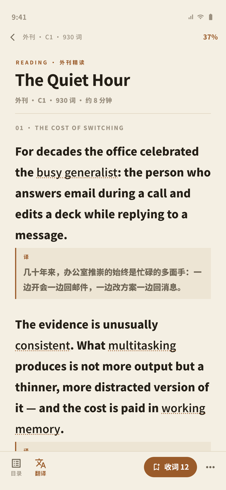
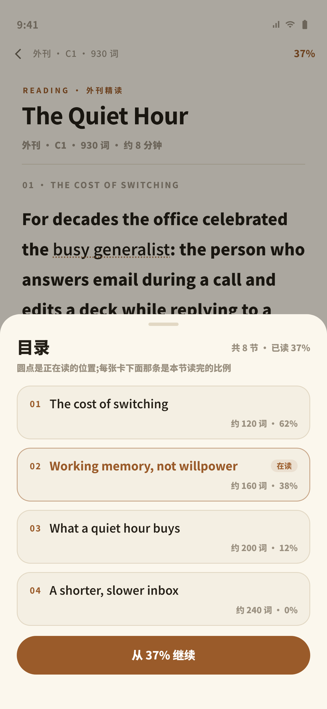
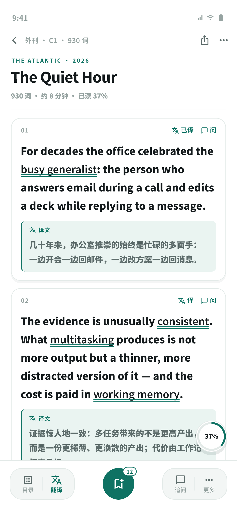
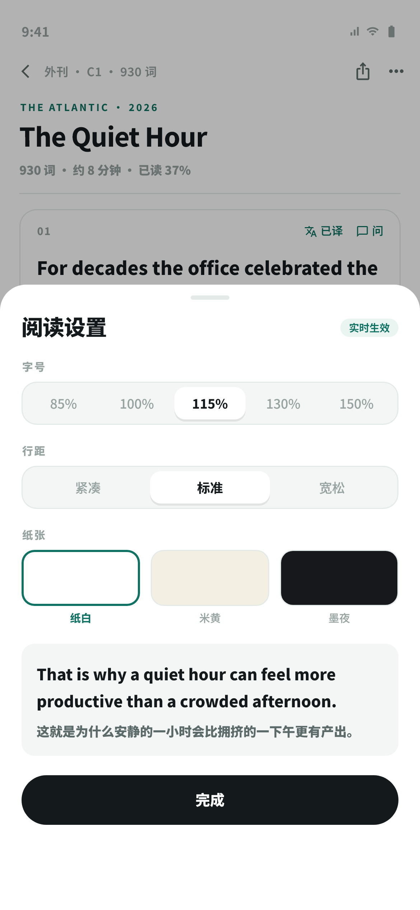
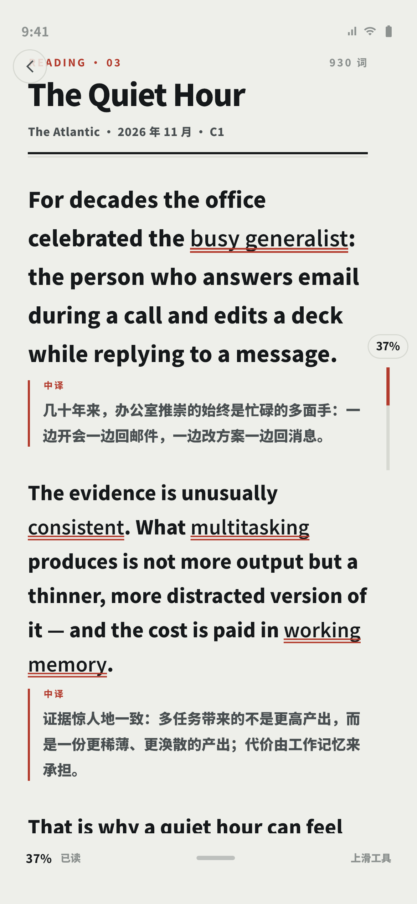
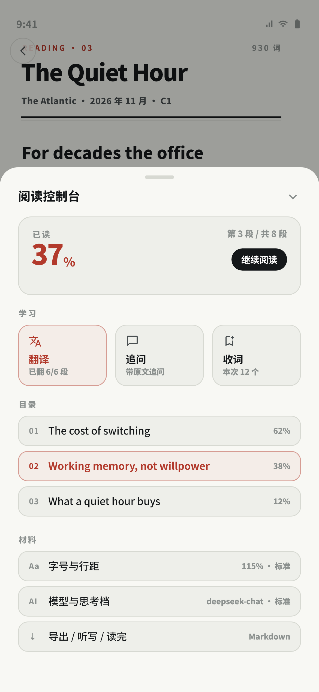

# 阅读器重设计 · 3 个结构不同的方案 + 真实渲染（2026-11-06）

> 用户真机反馈（本轮要解决的三件事）：
> 1. **底部 UI 拥挤且不统一**——一排「模型 / 译 / 收词 / 追问 / ↑」挤在一起；
> 2. **整体字体 / 色调非常差**；
> 3. 上下滑动**没有阅读进度百分比**。
>
> 规矩：先看方案 + 真图，选完再实现。**本文只出方案与规格，不改 `lib/` 一行生产代码。**
> 渲染图见 `docs/ui-preview/real/`，由 `test/reader_redesign_preview_test.dart` 生成
> （390×844 逻辑尺寸，`toImage(pixelRatio: 3)` → 1170×2532，真字体 + 真图标）。

---

## 0. 一句话结论

**推荐方案 A「书页」**：暖纸 + 19px 正文 + 底部只留 3 组动作 + 顶部 2px 进度条和右上角 `37%`。
它用**一次改动**同时回答三个抱怨（砍按钮 / 换整套色调与字阶 / 进度常驻），且是三个方案里
唯一**不需要碰其他页面、不需要改数据表**的；预计 0.5~1 天。

| | A 书页 | B 学习台 | C 版面 |
|---|---|---|---|
| 一句话 | 把阅读器做成一本纸书 | 把阅读做成一张学习工作台 | 把阅读器做成一份排好版的刊物 |
| 纸张 | 暖纸 `#F4EFE3` | 纯白 `#FFFFFF` + 卡片 | 冷灰纸 `#EEEFEA` |
| 强调色 | 赭石 `#9A5B2A` | 墨绿 `#0F7263` | 砖红 `#B23A2C` |
| 正文 | 19 / 1.92 | 17 / 1.78（段段是卡） | 18~20 / 1.8（首段更大） |
| 底栏 | **4 热区 / 3 组** | **5 热区 / 3 组**（两个胶囊 + 一个圆钮） | **0 按钮**（上滑控制台） |
| 进度 | 顶部 2px 条 + 右上 `37%` | 右下 52px 圆环 | 右侧悬浮 `37%` + 96px 竖轨道 |
| 弹层 | 目录 = 一节一张卡 | 设置 = 组标题 + 分段控件 | 控制台 = 4 组卡片 |
| 成本 | **0.5~1 天** | 1.5~2 天 | 2~3 天 |

---

## 1. 现状审计（file:line，都是可核对的）

### 1.1 底部为什么"拥挤"

`lib/widgets/reader_action_bar.dart` 是一条**单行 Row 里塞 6 个控件**，靠 `Flexible(flex:2/2/3/3/2)`
强行分配 320px 不到的可视宽度：

| 控件 | 行号 | flex | 问题 |
|---|---|---|---|
| 模型 + 思考档 `_ModelMenu` | 196–202 | 2 | 低频，属于"设置"，却占着最左 |
| 翻译 `ActionChip` | 206–231 | 2 | 与上方"翻译控制条"**状态双写**（见 1.2） |
| 丰富形式 `ActionChip` | 235–254 | 3 | 同功能在 `moreActions` 里**还有一个**（`material_reader_screen.dart:2500`） |
| 收词 `FilledButton` | 257–273 | 3 | 唯一主行动，但它和 4 个 chip 平级、只靠填充色区分 |
| 追问 `ActionChip` | 277–289 | 2 | — |
| 更多 `PopupMenuButton` | 292–320 | 图标 | 与顶部 AppBar 的「更多」**功能重复**（见下） |

**"不统一"是三种控件语言混用**：`ActionChip`（描边胶囊）/ `FilledButton`（实心）/ 纯图标 PopupMenu，
再加顶部 AppBar 的裸 `IconButton`——一屏里 4 套按钮形态。

**两套「更多」菜单重复**：

- 顶部 AppBar 菜单：`material_reader_screen.dart:2333–2406`，含 原文链接 / 阅读设置 / 目录 / 听写 / 导出 / 读完；
- 底部动作栏 `moreActions`：`material_reader_screen.dart:2499–2538`，含 丰富形式 / 原文链接 /
  阅读设置 / 听写 / 导出 / 读完。

→ 有 5 个条目在两个菜单里各出现一次，用户永远不知道"该点哪个"。

**底部实际占掉多少屏**（按代码推算，844 高屏）：

- `ReaderActionBar`：收词位置行 28（118–147）+ 按钮行 48（191–322）+ 内边距 4 + 外边距 12 ≈ **92px**；
- 翻译开着时再叠一条 `_buildTranslationTray`（`_buildTranslationTray` 687–818，外层 `Container`
  717 有实底色）：`ProgressStageBar` 三行（`lib/widgets/waiting.dart:282–408`：stage 12px / 进度条 /
  detail 11px / 取消按钮）+「翻译使用：…」一行（800–814）≈ **93px**；
- 合计 **≈185px = 屏高的 22%**，而正文 `ListView` 自己还留了 80px 的底部内边距
  （`material_reader_screen.dart:2469–2470`）——底部两层已经是 185，这 80 是真的白留；
- `↑` 是唯一真正浮在内容上的东西：`FloatingActionButton.small`（2542–2552），正好压在动作栏右上方。

### 1.2 翻译状态"浮层压正文" + 状态双写

- 翻译进度条虽然是 `Column` 里的一段（2481），不是真 overlay，但它**紧贴正文、带实底
  `surfaceContainerHighest`**（717–719），视觉上就是一条横在正文下面的灰带；
- 同一个"翻到哪了"在两个地方各说一遍：控制条的 `ProgressStageBar`（672–679）和动作栏的
  翻译 chip 高亮（reader_action_bar.dart:206–231）；
- 每段译文卡自己还带一个进度骨架屏（2650–2697），第三种"正在翻译"的表达。

### 1.3 目录 / 分类弹层为什么"大字裸列表"

| 弹层 | 行号 | 现状 |
|---|---|---|
| 目录 | `_showToc` 1355–1465 | 标题 20px / w900（1383–1389）+ `showDragHandle` + `ListTile(dense)` 裸列表 + `Divider(0.5)`（1410–1456）；每行只有 节名 13.5 + 「约 N 词」10.5，**没有卡片、没有分组、没有本节进度**，`maxHeight = 屏高 70%`（1366–1369） |
| 阅读设置 | `_showReaderSettings` 1120–1227 | 标题 20 / w900 + `Wrap` 圆角胶囊（1158–1200，`_sheetChip` 1085–1118）+ 14px 圆角预览块 |
| 保存分类 | `lib/screens/input/widgets/category_picker.dart:44–114` | 标题 20 / w900、副标 11.5、2 列卡片 |
| 收词确认 | `_showPickedSummary` 1982–2061 | `titleMedium` + `Chip` 堆 |

→ 四个弹层**四种视觉语言**（裸列表 / 胶囊组 / 卡片网格 / Chip 云），共同点是标题都用 20px w900——
"大字裸列表"就是目录那一个的真实观感。

### 1.4 正文排印参数（"字体差"的根因）

`lib/services/reader_settings.dart`：`baseFontSize = 16`（:38）、`defaultFontScale = 0.85`（:30）、
`defaultLineHeight = 1.7`（:35）、档位 `[0.85,1.0,1.15,1.3,1.5]`（:23）、行距 `[1.5,1.7,2.0]`（:33）。

| 元素 | 实际字号 / 行高 | 位置 |
|---|---|---|
| 文章标题 | 30 / 1.12 / w900 / -0.9 | `material_reader_screen.dart:1055–1066` |
| 正文 | **16 × 0.85 = 13.6 / 1.7**，无字距、无最大行宽 | `_buildUnit` 2844–2847 |
| 译文 | **13.76 × 0.86 = 11.7 / 1.615**（`_lineHeight*0.95`） | `_buildTranslationArea` 2752–2759 |
| 元信息 | 11.5（1073–1074）/ 顶栏 11（2314–2319） | — |
| 底栏 chip 文字 | 12–13（reader_action_bar 216–222 / 262–265） | — |
| 弹层标题 | 20 / w900（1146–1149、1384–1387、category_picker 57–63） | — |
| 生词下划线 | `reader_text.dart:130–139`（primary 色 + dotted + alpha 60） | — |

通读一遍就能看出问题：一屏里同时存在 **30 / 20 / 13.6 / 12 / 11.7 / 10.5 / 9.5** 七种字号，
**正文只有 13.6，比弹层标题 20 小 32%**——正文不是主角，弹层标题才是；译文 11.7 比正文还小还挤，
读英文的人最需要的那一层（中文对照）是全屏最费眼的。另外正文最大行宽 = 屏宽 − 32 = 358px
（2469–2470），19 号以上正文在手机上会显得"一行太长"。

### 1.5 进度百分比：数据**已经存在**，只是没显示对（关键结论）

**（a）落库字段早就有了**

| 事实 | 位置 |
|---|---|
| `material_progress.percent REAL DEFAULT 0` | `lib/services/database.dart:514` |
| `material_progress.position INTEGER DEFAULT 0` | `lib/services/database.dart:513` |
| 写库 API `DatabaseService.upsertMaterialProgress(materialId, {required int position, required double percent, …})` | `lib/services/database.dart:2813–2850` |
| 阅读器写进度（退出/滚动节流 3s/换段必写） | `material_reader_screen.dart:1287–1347`，写入点 1318–1326 |
| 读回进度 | `material_reader_screen.dart:1584–1585`（`position` / `percent`），续读弹层用它 1517 |
| 书架 / 材料中心已经在展示 percent | `database.dart:2916–2917`、`4651–4652` |

**（b）有两个"百分比"，一个是粗的、一个是准的**

- 粗（落库用）：`percent = (_lastChunkIndex + 1) / _chunks.length * 100`，`material_reader_screen.dart:1309–1311`。
  分母是 **2500 词一块的"块"**，典型一篇文章只有 1 块 → 落库 percent 永远是 0 或 100。
- 准（实时用）：`ratio = _scrollCtrl.offset / _scrollCtrl.position.maxScrollExtent`，
  `_onScroll` 1263、标题卡 `_readingLead` 1014–1020 用同一个公式。

**（c）为什么用户"上下滑动没有进度百分比"——两个原因叠在一起**

1. `_onScroll`（1256–1276）**从头到尾没有 `setState`**：它只更新 `_lastChunkIndex`、调
   `_persist()`（内部自己 return，不触发重建）和 `_scheduleVisibleTranslation()`。
   → 即使那个 `$pct%` 有值，滚动时也**不会刷新**。
2. 那个 `$pct%` 画在 `_readingLead` 里（1045–1051，字号 10.5、`inkFaint`），而 `_readingLead`
   是列表第 0 项（2472–2474）——**一往下滑就滚出屏幕**。

所以"上下滑动没有进度"不是没数据，是**没有常驻容器 + 没有重建**。

---

## 2. 方案 A · 书页（推荐）





**主张**：阅读器不该有"工具栏感"。正文是唯一主角，其余动作要么在手指自然落点，要么藏起来。

### 2.1 配色与纸张

| 令牌 | 值 | 用途 |
|---|---|---|
| `paper` | `#F4EFE3` | 页面底（暖纸，不是白） |
| `sheet` | `#FBF7ED` | 弹层底（比纸再亮一档） |
| `ink` | `#241F17` | 正文（暖黑，不是纯黑） |
| `inkSoft` | `#6E6555` | 译文 / 次要文字 |
| `inkFaint` | `#9A9080` | 元信息 / 标签 |
| `hairline` | `#E2D8C4` | 1px 分隔线 |
| `accent` | `#9A5B2A` | 唯一强调色（赭石）：进度、生词下划线、主按钮、在读标记 |
| `transBg` | `#EDE5D4` | 译文块底 |

彻底不用 `V4Skin` 的果冻蓝 `#4C5AF0` / 粉 `#FF7FA8`——这是"色调差"的直接解法：阅读器从一个
"彩色 App 里的一个页面"变成"一张纸"。

### 2.2 字阶（4 档，正文主导）

| 层级 | 字号 / 行高 / 字重 / 字距 | 颜色 |
|---|---|---|
| 文章标题 | 27 / 1.16 / w800 / -0.4 | `ink` |
| 栏目标签（kicker） | 9 / 1.2 / w800 / +2.2 | `accent` |
| **正文** | **19 / 1.92 / w400 / +0.05** | `ink` |
| 节标题 | 10 / 1.3 / w800 / +1.4 | `inkFaint` |
| **译文** | **14 / 1.85 / w400** | `inkSoft` |
| 元信息 | 11 / 1.5 / w500 / +0.2 | `inkFaint` |
| 底栏图标文字 | 9.5 / 1.1 / w500 | `inkFaint` |

正文 19/1.92 ≈ 每行 36.5px，中文一行约 17 字、英文约 33 字符——这是长文连续阅读的舒适区；
译文比正文小 5 号但行高只小 0.07，不再"挤成一坨"。

### 2.3 底部操作栏：3 组 / 4 个热区 / 高 65px

```
[目录] [翻译]      ⋯ 收词 12(实心)  ⋯
 └─ 左组(阅读)      └ 中/右(行动)
```

| 位置 | 内容 | 说明 |
|---|---|---|
| 左组 | `目录`、`翻译` | 20px 图标 + 9.5px 文字；翻译开着时图标与文字变赭石 |
| 右侧主按钮 | `收词 12` 实心胶囊（h 38） | **全屏唯一实心控件**，收藏动作有且只有它 |
| 最右 | `⋯` 22px 裸图标 | 打开「更多」面板：模型与思考档 / 丰富形式 / 阅读设置 / 听写 / 导出 / 读完 / 原文链接 |

下沉清单（从 6 个热区砍到 4 个）：**模型菜单 → 「⋯」面板**（低频，不该常驻）、
**丰富形式 → 「⋯」面板**、**追问**：A 方案里从底栏移出，改为"点译文 / 长按选中 → 询问 AI"
（`reader_text.dart` 已有 `askAi` 动作，本来就是更贴近上下文的入口）。

### 2.4 进度百分比：顶部 2px 通栏条 + 右上角`37%`

- 位置：状态栏 → **工具行（40px）** → **2px 通栏进度条** → 正文；
- 右上角 `37%` 常驻（11.5 / w800 / `accent`），细条是它的图形化；
- 实现：`ValueNotifier<double>` + `ValueListenableBuilder` 只重建这 2 个像素级组件，**不 setState 整屏**；
- 点右上角 `37%` → 弹一条「跳到 37%」的快捷条（可选，二期）。

选它的理由：2px 条不占布局、永远在视野里、不遮正文，也不会像 FAB 一样和动作栏抢位置。

### 2.5 目录弹层：一节一张卡

- 顶部抓手 36×4 + 标题「目录」20/w900 + 右侧「共 8 节 · 已读 37%」；
- **一节一张卡**：圆角 16、1px `hairline` 边框、纸底；卡内两行
  ——第一行 `01`（10/w800/`accent` 字距 1）+ 节名（14/w600）+ 「在读」徽标；
  第二行 **本节进度条（3px）+「约 260 词 · 62%」**；
- 正在读的那节用赭石边框 + 赭石标题；
- 底部主按钮「从 37% 继续」。

### 2.6 正文排印规则

- 最大行宽：屏宽 − 52（左右各 26）→ 390 屏上 338px，19 号正文约 17 字/行；
- 段间距 22；节标题上空 18、下空 12；首屏顶部 kicker 9 + 标题 10 + 元信息 10 + 分隔线 + 18；
- 生词：`FontWeight.w600` + 1.5px 赭石**虚线**下划线（保留"可点"的暗示，但不再是蓝色链接感）；
- 译文：段下 8px 起，左 2px 赭石竖线 + `#EDE5D4` 底 + 上「译」9/w800，正文 14/1.85。

### 2.7 与输入板块的连续性

输入页（拍照 / 材料录入）继续用现有 `V4Skin.jellyLight`；阅读器局部覆写 8 个色值即可
（新增 `ReaderPaper` 一组常量，不进 `v4_theme`）。**唯一跨页影响**：`ReaderSettings` 的字号档位
建议从 `[0.85,1.0,1.15,1.3,1.5]` 改为 `[0.9,1.0,1.1,1.2]`（基准 19），旧值 0.85 会被
`_nearestScale` 自动夹到 0.9，不需要写迁移。

### 2.8 改动文件与成本（≈ 0.5~1 天）

| 文件 | 改动 |
|---|---|
| `lib/widgets/reader_progress.dart` | **新增** ~60 行：2px 条 + 百分比标签（接收 `ValueListenable<double>`） |
| `lib/widgets/reader_action_bar.dart` | 重写为 A 的 4 热区（保留 `ReaderMoreAction` 数据结构，弹层化）~180 行 |
| `lib/screens/input/material_reader_screen.dart` | 顶栏/进度条/正文样式/译文样式/目录弹层；删除翻译控制条与 FAB ↑（~120 行改动，无新增业务逻辑） |
| `lib/services/reader_settings.dart` | 档位与默认值（6 行） |

风险：低。不动数据库、不动 Provider、不动其他页面；`reader_action_bar.dart` 若还想保灰度，
可新建 `reader_action_bar_v2.dart` 由 `MaterialReaderScreen` 直接调用。

---

## 3. 方案 B · 学习台





**主张**：读一篇材料=做一次学习任务。每段是一张可操作的卡，底部是三个语义分组的仪表。

- **配色**：页面 `#FFFFFF`、次级面 `#F3F6F5`、墨 `#141A1C`、次要 `#5C6B6A`、极淡 `#96A3A1`、
  线 `#E3EAE8`、强调 **墨绿 `#0F7263`**、译文底 `#EAF4F1`。
- **字阶**：标题 24/1.2/w800/-0.5；正文 **17/1.78**；译文 13.5/1.75；元信息 11/1.4；
  卡内微动作 10.5；段落序号 9.5/w800/+1。
- **正文结构**：段落 = 一张卡（圆角 16、1px 边框、微投影、内边距 15/13/15/14），
  卡头一行：`01` + 右侧 `译` / `问` 两个微动作；卡内译文是浅薄荷区（左 2px 墨绿、圆角 8）。
- **底栏：3 组 / 5 热区 / 高 86px**：左胶囊 `[目录 | 翻译]`（高 52、圆角 20、内含 1px 分隔线）
  + 中央 **52px 实心圆按钮「收词」带 `12` 角标** + 右胶囊 `[追问 | 更多]`。三组等距 `spaceBetween`。
- **进度**：右下 **52px 悬浮圆环**（描边 3.2、环内 `37%`、白底+阴影），同时兼任"回到顶部"
  （替掉现在那个 `↑` FAB）；正文头部再写一行「已读 37%」做文字兜底。
- **弹层**：全部统一为「组标题（10/w800/+1.2）+ 控件」——字号 = 5 段分段控件、行距 = 3 段、
  纸张 = 3 个色卡（纸白 / 米黄 / 墨夜），底部一张实时预览卡（14.5/1.7 + 译文 12/1.7）。
- **与输入板块**：需要新增一组 mint 令牌（`V4Skin` 加 `flavor: mono/green` 或用局部常量）；
  卡片语言与材料中心一致，连续性反而是最好的。
- **成本**：1.5~2 天。要点是"段落卡化"——`_buildUnit` 要从 `Padding+Column` 改成卡片容器，
  且 `_unitKey` 的可见性判断（`_visibleTimer` / RenderBox）需要回归测试。
- **代价**：卡片会把长文切成"清单"，连续阅读的沉浸感弱于 A；右下圆环在滚动时仍会压住正文右下角
  约 36×52 的区域（已用 120px 底部内边距保证停住时不遮字）。

---

## 4. 方案 C · 版面





**主张**：底部一个按钮都不要。阅读器默认是"纯版面"，所有工具在一次上滑里。

- **配色**：冷灰纸 `#EEEFEA`、弹层 `#F8F8F4`、近黑 `#15181A`、次要 `#494F51`、极淡 `#8C918F`、
  线 `#D7D9D2`、唯一强调 **砖红 `#B23A2C`**。
- **字阶（编辑部口味）**：标题 **28/1.1/w900/-0.8**；栏目标签 9.5/1.3/+1.6；署名 10.5/1.4/+0.3；
  **首段 20/1.82**（导语），其余正文 **18/1.8**；译文 13.5/1.8；顶部粗线 2px + 细线 1px 组成"刊头双线"。
- **零常驻按钮**：底部只有 —— 贴底 **2px 进度线** + **42px 把手区**（左 `37%` / 中间 36×4 抓手 /
  右「上滑工具」hint）。没有图标按钮、没有 FAB。
- **进度**：右侧悬浮 `37%` 胶囊（10.5/w800，白底 0.92 + 边框）+ **96px 竖轨道**（3px 宽，砖红填充 37%）；
  正文右侧内边距 46 给它让位。
- **弹层（上滑「阅读控制台」，560~640px）4 组**：
  1. 进度卡：`已读` + 「第 3 段 / 共 8 段」+ **34px `37`** + 「继续阅读」按钮 + 3px 进度线；
  2. 学习：3 个等宽方块（翻译 / 追问 / 收词 12）；
  3. 目录：3 行紧凑行（序号 + 节名 + 本节 %）；
  4. 材料：字号与行距 / 模型与思考档 / 导出·听写·读完。
- **与输入板块**：风格跳得最远（去圆角、冷灰、砖红），需要一组新令牌，且所有弹层要重排 → 改动面最大。
- **成本**：2~3 天。**代价**：零常驻按钮有学习成本（用户要记住"上滑"），对非专业用户不友好；
  进度竖轨贴正文右边缘，需要正文右侧让位 12px。

---

## 5. 三个方案对照（按用户三条抱怨逐项打分）

| 用户的抱怨 | A 书页 | B 学习台 | C 版面 |
|---|---|---|---|
| 底部拥挤（6→?） | **4 热区 / 3 组**，高 65 | 5 热区 / 3 组，高 86 | **0 按钮**，高 66 |
| 不统一（4 套控件语言） | **1 套**（图标+文字，唯一实心=收词） | 2 套（胶囊组 / 圆主按钮） | 1 套（无控件） |
| 色调差 | 去掉果冻色，8 个暖纸令牌 | 白+墨绿，卡片层级 | 冷灰+砖红，编辑部 |
| 字体差（7 种字号无关系） | **4 档，正文 19 主导** | 5 档，卡片内 17 | 6 档，首段 20/正文 18 |
| 进度常驻 | 顶部 2px + 右上 % | 右下圆环 | 右侧悬浮 + 竖轨 |
| 弹层"大字裸列表" | 一节一张卡（含本节进度） | 组标题+分段控件 | 4 组控制台卡片 |
| 实现成本 | **0.5~1 天** | 1.5~2 天 | 2~3 天 |
| 与其他页面的一致性风险 | **最低**（只覆写 8 个色） | 中（新增 mint 令牌） | 高（新令牌 + 全弹层重排） |

---

## 5.5 与既有规范的关系（读 `docs/V4-ART-DIRECTION.md` + `docs/V5-READER-DESIGNS.md` 之后）

先说清楚**这一轮不是上一轮的重来**：`V5-READER-DESIGNS.md` 的三个方向里用户选了 A「沉浸纸面」，
现在 `material_reader_screen.dart:2272–2276` 就是那个 Plan A（`paperBg = #F7F4EC`）。
真机被否的是**已实现的 Plan A**，所以本轮三个方案都不是"把 V5 的 A 再讲一遍"：
A 换了底栏结构（6→4 热区）与字阶（7 种字号→4 档），B/C 是两条新路。

`V4-ART-DIRECTION.md` 的三条原则（内容第一 / 秩序 / 克制）本轮全部保留，但有 **4 处有意偏离**，
写在这里免得实现时被当成 bug 改回去：

| V4-ART-DIRECTION 的规则 | 本轮怎么做 | 为什么 |
|---|---|---|
| 「正文行高 1.5–1.6」（§二原则 2 / §三 排版） | 阅读器正文 **1.78–1.92** | 那条是**界面正文**（卡片/列表）的规范；长文连续阅读在手机上低于 1.8 必然挤，19px 正文配 1.92 才是"读得下去"的区间。建议在 `reader_settings.dart` 注释里标明这是"阅读排印"专属，不进 `AppFont` |
| 「玻璃底栏/浮层，模糊 12–18」（§三材质、炫技清单 #7） | 三个方案**都不用玻璃**，改实心纸/白条 | 现状底栏是"伪玻璃"（半透明白 + 圆角 24 + 阴影，见 `reader_action_bar.dart:98–113`），压在暖纸上就是"两块白浮在纸上"——正是用户说的"不统一"。阅读器底部需要的是"纸的一部分"，不是浮层 |
| 「字阶 7 档 11/12/14.5/16/18/22/30」（§二原则 2） | 阅读器新增 19 / 14 / 10.5 / 9.5 四档，**不写进全局 `AppFont`** | 阅读排印的字号由"行长 × 行高"决定，不能和界面字阶共用；新增档位只活在 `ReaderSettings` 里，避免牵动 100 个页面 |
| 「13 域身份色 / 头图渐变」 | 阅读器**不用域色、不用头部渐变** | 用户否掉的正是"彩色大头部"；阅读器里的身份由「外刊 · C1 · 930 词」这一行文字承担，颜色全部让给正文与强调色 |

圆角也一并说明：A 的卡片用 **16**（`design_tokens.dart` 的 `Radii.card = 20` / `V4Skin.cardRadius = 26`），
因为纸感要"更硬一点"；若要严格守令牌，把 16 改成 20 不影响任何布局。

---

## 6. 推荐：方案 A，理由三条

1. **它一次正中三个抱怨，且每个都是结构性的**：底栏 6→4 是结构（不是换皮）；色/字是换整套
   （8 个令牌 + 4 档字阶，正文 13.6→19）；进度是新增常驻容器（2px 条 + 右上角），不是把旧文字
   挪个位置。
2. **它是唯一"只动阅读器"的方案**：B 要改段落结构（牵连可见段判断/翻译锚点），C 要重排全部弹层。
   A 的改动集中在 1 个新组件 + 3 个文件，其他页面零影响，非专业用户也能在真机上第一时间看到
   差别而不是先看到 bug。
3. **它最保守地回应了"别开盲盒"**：A 的每一个数值（纸色、字号、行高、底部高度）都能在本目录的
   渲染图里核到；用户看到的就是能实现的，没有"设计稿很美、实现打折"的空间。

**建议的落地节奏**：先做 A（0.5~1 天）→ 真机放一周 → 如果用户仍然觉得"学习动作不够显眼"，
再把 B 的**底栏分组**（左胶囊/圆主按钮/右胶囊）叠到 A 的纸面上——A 的正文 + B 的分组底栏是
可以组合的（底栏高度 65 → 86 二选一，其余不冲突）。

**不要**三个方案混做：C 的"零按钮"和 B 的"五热区"是互斥的交互哲学，混在一起就是现在这个
"什么都有、什么都不明确"的状态。

---

## 7. 「进度百分比」最小实现路径（可直接开工）

### 7.1 数据来源结论（一句话）

**已经有了，不用建表、不用改 schema**：`material_progress.percent`（REAL）+ `position`（INTEGER）
由 `DatabaseService.upsertMaterialProgress()` 写入（`database.dart:2813`），阅读器在
`_persist()`（`material_reader_screen.dart:1287–1347`）里写；滚动时真实的 0~1 比例由
`_scrollCtrl.offset / maxScrollExtent` 给出（`_onScroll` 1263 / `_readingLead` 1014–1020）。

**要做的是三件事**：把它常驻显示、让它在滚动时**重建**、把落库的 percent 从"按块粗估"换成真实比例。

### 7.2 步骤

**Step 1** · 新增一个只通知进度组件的 notifier（不 setState 整屏）

```dart
// material_reader_screen.dart,State 字段区(约 72 行附近)
/// 阅读进度(0~1)。用 ValueNotifier 而不是 setState:滚动每帧都变,
/// 整屏重建会让翻译卡片/段落手势跟着重建,低端机掉帧。
final _readingPercent = ValueNotifier<double>(0);
```

**Step 2** · 在 `_onScroll()` 里更新（1256–1276）

```dart
void _onScroll() {
  if (!_scrollCtrl.hasClients) return;
  final max = _scrollCtrl.position.maxScrollExtent;
  if (max <= 0 || _chunks.isEmpty) return;
  final ratio = (_scrollCtrl.offset / max).clamp(0.0, 1.0);
  _readingPercent.value = ratio;          // ← 新增这一行
  _lastScrollRatio = ratio;               // ← 新增:落库用真值
  // …原有 _lastChunkIndex / _persist / _scheduleVisibleTranslation 不动
}
```

**Step 3** · 在 `build()` 顶部加常驻进度（A 方案位置：工具行下沿）

```dart
// 顶部:2px 通栏 + 右上角百分比,任何滚动位置都在
ValueListenableBuilder<double>(
  valueListenable: _readingPercent,
  builder: (_, ratio, __) => ReaderProgressBar(
    value: ratio,
    label: '${(ratio * 100).round()}%',   // 用 round,不用 floor:99.6% 显示 100%
  ),
),
```

`lib/widgets/reader_progress.dart`（新文件，~60 行）：`SizedBox(height: 2)` 双色 Row +
可选 `Text`；内置 `RepaintBoundary` 减少重绘。

**Step 4** · 落库用真实比例（替换 1309–1311 的按块粗估）

```dart
final percent = finished ? 100.0 : (_lastScrollRatio * 100).clamp(0.0, 99.0);
// 未读到底最多 99:100 留给「读完了」这个动作,否则进度条会假到 100
```

**Step 5** · 读回/续读按比例跳（可选，二期）

`_scrollToChunk()`（1468–1488）现在是按"块→单元"比例跳，改成 `_scrollCtrl.jumpTo(max * percent / 100)`
更准；`_askResume`（1491–1560）已经有 `percent`，文案不用改。

### 7.3 不做的事 / 注意

- **不改表结构**：`percent` / `position` 已存在（database.dart:513–514），老数据 percent=0 也能显示（0% 是真值）。
- **不改其他读取方**：书架、材料中心已经在读 percent（database.dart:2916、4651），A 方案只让这个值变准，不引入新字段。
- **别用 `setState` 做进度**：`_onScroll` 已经在跑翻译调度与落库，整屏重建会让 `_buildUnit` 里
  `TappablePassage` 的上千个 `TapGestureRecognizer` 跟着重建（`reader_text.dart:120–140`），必然掉帧。
- **方向**：材料可能很长（一本书），`_units` 是懒加载的，`maxScrollExtent` 在"还没加载到后面"时会偏小
  → 进度会跳。A 方案的顶栏百分比加一句注释说明这是"内容比例"，必要时用
  `(已读块 + 块内比例) / 总块数` 做二次校准（二期，不影响一期上线）。

---

## 8. 验收清单（用户选完 A 之后照着测）

1. 首屏：顶部工具行 + 2px 进度条 + 右上 `37%`，正文 19 号、每行约 17 个汉字；
2. 上/下滑：`37%` 数字与 2px 条**连续变化**，不卡顿、不闪（只重建进度组件）；
3. 底部：只有 4 个热区，`收词` 是唯一实心；翻译开着时底部**不再多出一条灰带**；
4. 点译文 → 追问；长按选词 → 「询问 AI / 收藏进单词本」；`询问 AI` 从此也是"追问"入口；
5. 目录：一节一张卡，正在读的那节有赭石边框，卡上有本节进度；
6. 退出重进：`material_progress.percent` 是真实比例（不再是 0/100）；
7. 书架/材料中心的进度条与阅读器里一致（同一个 percent）。
