# 开屏动画 + Logo · 3 方案（第 3 版 · 美术规格版 · 可直接进包）

> 本版按 Lead 给的美术规格重画：背景 160° 三段渐变 + 三团柔光斑 + 3% 噪点、琉璃 132×132 有可见填充、
> logo 白色带投影、字标 32px w800 不再发灰、B 环改 #5B6CFF→#C86BFF 双色 3px、节点 9/13/9。
> 三方案都是**纯 Flutter 绘制**（`CustomPainter` / `BackdropFilter` / `AnimationController`），
> 无视频、无图片、无新依赖。渲染帧在 `docs/ui-preview/real/splash-*.png`。
>
> **不改生产代码**——本文后面附了"实现规格"，用户选定即可照着落地进包。
>
> **本版已自检**（出图后用 `read_image` 逐张看过）：文字无方块、无黄下划线；
> 字标 `#1E2233` 不发灰；琉璃块有可见填充渐变 + 1.5px 白色内高光边 + 柔影；
> A 的「引号 + 星芒」合成一个 mark；B 的环是 #5B6CFF→#C86BFF 双色 3px；C 的气泡有 2px 白边与投影。

---

## 0. 结论速览

| | **A 琉璃凝结 · 双元素汇合** | **B 双轨闭环** | **C 对话体** |
|---|---|---|---|
| 一句话 | 琉璃块里「引号（language）」与「星芒（AI）」两条元素**相向滑入、碰撞、合成一个标** | 外环是**一行流动的字**（language），内环是双色渐变弧 + 3 颗节点（AI），双轨同向流转后收进环心 | 琉璃气泡里 `language` 逐字打出，**最后一个字符被星芒顶掉** |
| language 在哪 | 两个逗号引号（左下） | 外环 36 个长短笔画 | 逐字打出的 `language` |
| AI 在哪 | 四角星芒 + 3 颗节点（右上） | 内环弧 + 3 颗绕行节点 + 跑动光点 | 顶替末字符的星芒 |
| 终标 | Logo 1「引号 · 星」 | Logo 2「A · 节点」 | Logo 3「气泡 · 星」 |
| 时长 | 1.42s | 1.45s | 1.44s |
| **最能打的一张** | `splash-a-f4.png`（终帧：琉璃块 + 合成标 + 字标） | `splash-b-f2.png`（双轨同时在场、光点在跑） | `splash-c-f3.png`（星芒顶掉末字符的瞬间） |
| 交付 | f1–f4 + dark | f1–f4 + dark | f1–f4 + dark |

**推荐 A**：终标里「引号」和「星芒」**两个元素物理并存、各占一块**，一眼读出 language + AI；
动画又把"AI 与语言走到一起"直接演了一遍；且琉璃块（用户点名的材质）是画面主体。

---

## 1. 统一美术规格（三方案共用，就是这版的"为什么不再淡"）

| 项 | 规格 |
|---|---|
| 背景 | 线性 160°：`#F2F5FF → #EDEBFF → #FDF7F4`；上叠三团柔光斑：`#7C9BFF` 22%（左上）、`#C7B6FF` 18%（右中）、`#FFD9E8` 16%（底部），整层 `blur 64`；再叠 **3% 细噪点**（`CustomPainter` 定种子画点，不引资源） |
| 琉璃块 | **132×132 / 圆角 40**；填充渐变 `#FFFFFF@0.55 → #DDE3FF@0.35`；**1.5px `#FFFFFF@0.9` 内高光边**（inset 1.5）；外阴影 `0 24 60 rgba(96,110,255,0.22)`；顶部内高光；斜向 120° 白色高光带（40% 宽，缓慢扫过） |
| Logo 主形 | 纯白 `#FFFFFF` + 投影 `rgba(50,60,150,0.25)` `blur 6`（同一 Path 画两遍：虚影层 `ImageFiltered(blur 6)` + 白标层）；主形尺寸 **84**（块 132 内留 24 边距） |
| 字标 | 「AI上外语」**32px / w800 / letterSpacing 2 / `#1E2233`** |
| 副标 | 「让语言,回归本质」**15px / letterSpacing 3 / `#1E2233@0.55`**（读 `SplashSettings.tagline()`，用户可自定义） |
| 跳过提示 | 「轻触任意处跳过」**12px / `#1E2233@0.35`**，底部 40，0.7s 后浮现 |
| 深色 | 底 `#0E1220 → #141A2E`；琉璃 `#FFFFFF@0.08 → #8FA0FF@0.16`；文字 `#F5F6FF`；其余同构 |
| 品牌色 | `#5B6CFF`（主）/ `#C86BFF`（副，只用于 B 的环渐变末端与跑动光点） |

---

## 2. 方案 A · 琉璃凝结（双元素汇合）

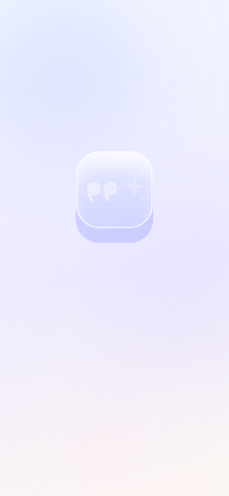
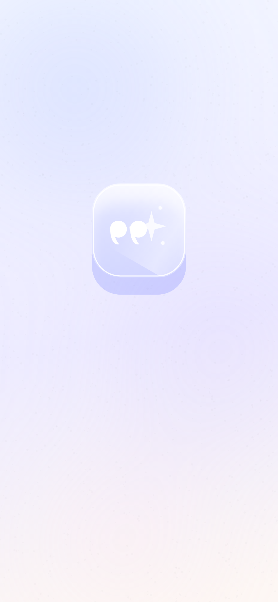
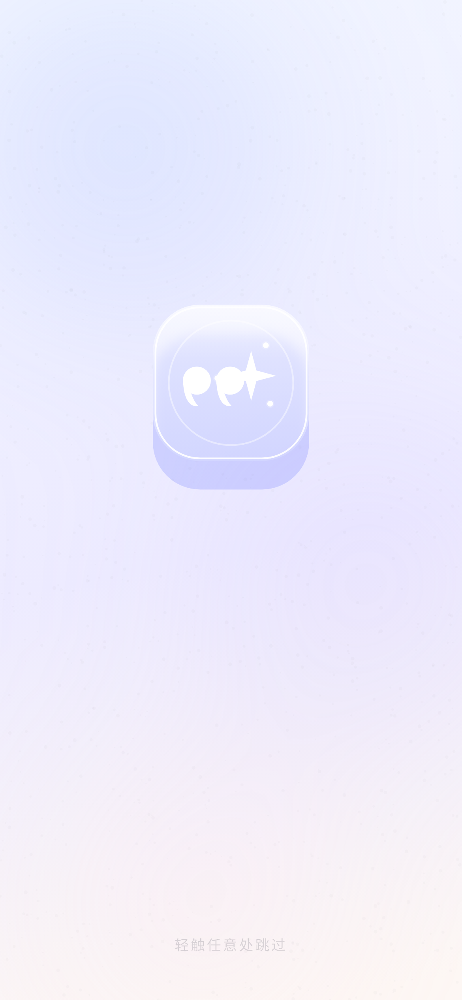
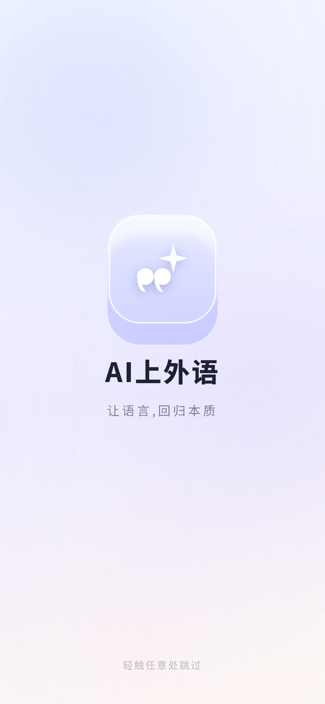

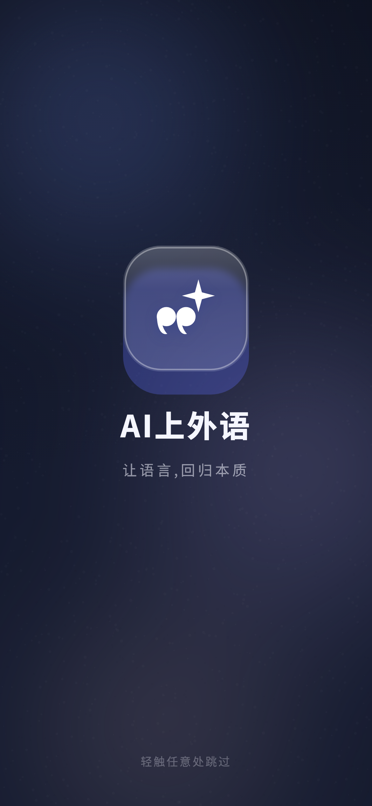

**概念**：一块 132 琉璃浮在极光上；**引号**从左滑入、**星芒**从右滑入；两层在块心**相撞**
（融合波），合成「引号 · 星」，字标与副标依次浮出。

**为什么贴合**：用户要的"琉璃玻璃"是主角；而「引号 = language / 星芒 = AI」是两个**独立可辨识**的元素，
动画把它们"走到一起"的过程演给用户看 —— 这就是产品论点。

### 2.1 时序表（总 1.42s；1.6s 内静止 → 250ms 交叉淡出）

| 层 | 属性 | 起–止 (ms) | 曲线 |
|---|---|---|---|
| 背景极光 | opacity 0.60→1.00 | 0–420 | easeOutCubic |
| 琉璃块 | opacity 0→1；scale 0.92→1.00 | 0–420 | easeOutCubic |
| 块内磨砂 | BackdropFilter sigma **16→4** | 260–900 | linear |
| 高光带 | x −0.8W→1.8W | 480–900 | linear |
| **语言层（引号）** | opacity 0→1；x **−62→−17** | 200–620 | easeOutCubic |
| **AI 层（星芒+节点）** | opacity 0→1；x **+62→+17**；scale 0.74→1 | 280–740 | easeOutCubic |
| 汇合波 | 直径 30→150，opacity 0.6→0 | 800–1020 | easeOutCubic |
| 两层淡出 | opacity 1→0 | 880–1020 | linear |
| 合成标 | opacity 0→1；scale 0.90→1 | 980–1180 | easeOutCubic |
| 字标 | opacity 0→1 | 1000–1320 | linear |
| 副标 | opacity 0→1；y 10→0 | 1080–1420 | easeOutCubic |
| 跳过提示 | opacity 0→0.85 | 700–1000 | linear |

### 2.2 帧说明

- `f1`（t=0.40）：引号已到左侧、星芒刚进右侧 → **两个元素分开**；
- `f2`（t=0.66）：两者靠近，中间还留缝；
- `f3`（t=0.86）：两层几乎重合 + 融合波扩散 → **相撞瞬间**；
- `f4`（t=1.50）：合成标 + 「AI上外语」+ 副标（终帧，动画早已结束，取静止画面）。

---

## 3. 方案 B · 双轨闭环

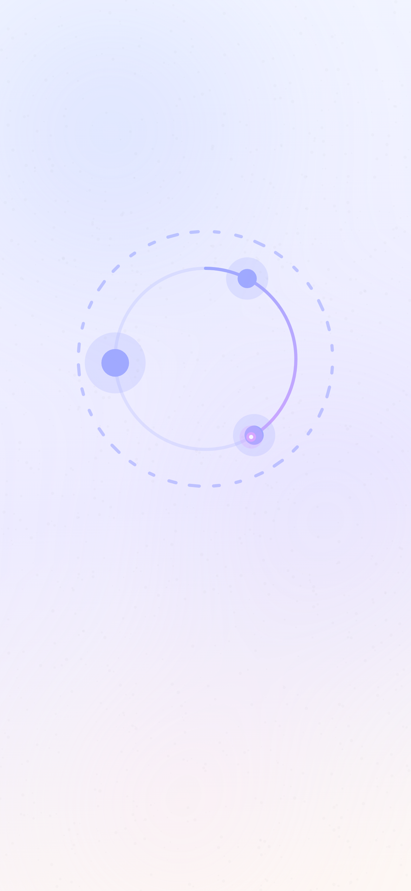
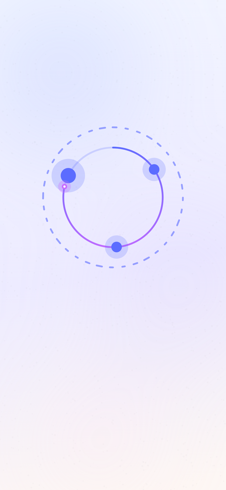
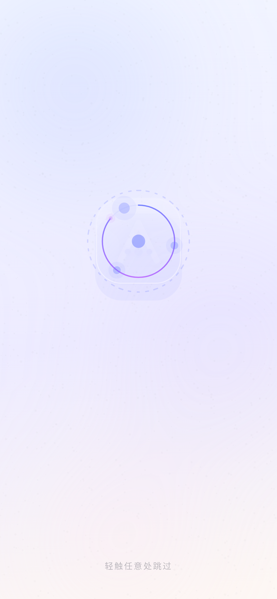
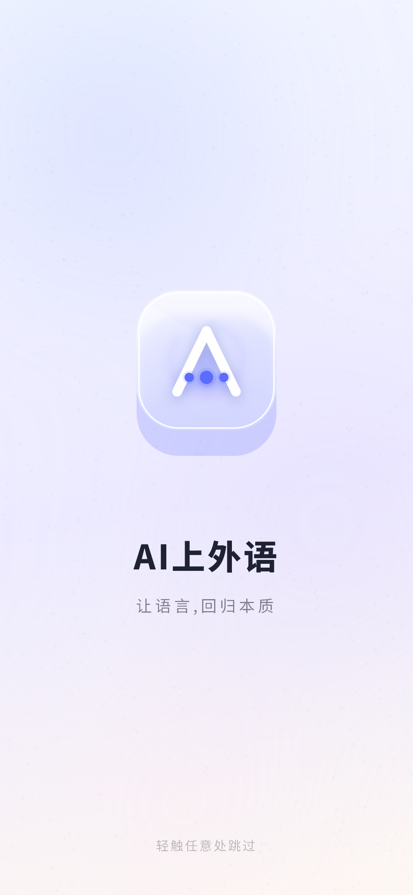

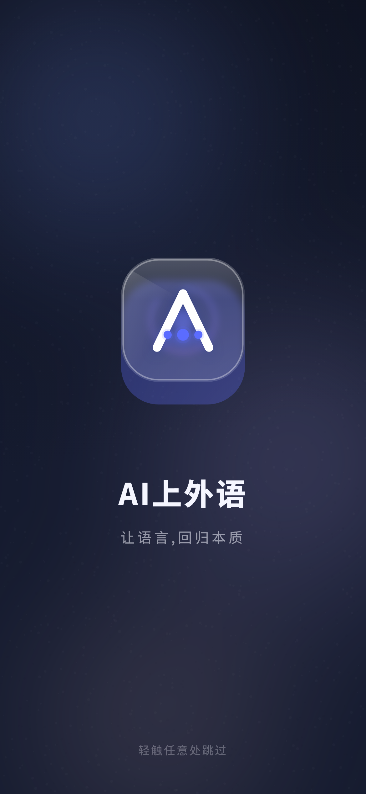

**概念**：外环 36 个长短交替的笔画 = **一行沿环流动的字**（language，慢转 0.34 rad/s）；
内环是 **3px 双色渐变弧（#5B6CFF→#C86BFF）+ 3 颗节点 + 跑动光点**（AI，快转 1.55 rad/s）；
双轨同向流转 → 一起收进环心 → 琉璃块里出现「A · 节点」。

**为什么贴合**：底部四个 tab 的语义就是**输入 → 输出 → 助理 → 我的**（`bottom_nav.dart:61–66`）。
"语言慢 / AI 快"的节奏差本身就是叙事；环收进环心 = 学习闭环收束。

### 3.1 时序表（总 1.45s）

| 层 | 属性 | 起–止 (ms) | 曲线 |
|---|---|---|---|
| 背景极光 | opacity 0.50→0.95 | 0–400 | easeOutCubic |
| 外环（语言流） | opacity 0→1；持续旋转 0.34 rad/s | 0–500 | easeOut |
| 内环弧 | 扫过 0→86%×360° | 100–950 | easeOutCubic |
| 内环节点 ×3 | 持续旋转 1.55 rad/s | 100 起 | 线性 |
| 跑动光点 | 随弧扫过 | 100–950 | — |
| 双轨收束 | scale 1→0.40；opacity 1→0 | 950–1250 | easeOutCubic |
| 琉璃块 | opacity 0→1；scale 0.82→1；sigma 14→4 | 980–1220 | easeOutCubic |
| 「A · 节点」 | opacity 0→1 | 1000–1240 | linear |
| 字标 / 副标 | 同 A | 1050–1380 / 1120–1440 | 同 A |
| 跳过提示 | opacity 0→0.85 | 700–1000 | linear |

---

## 4. 方案 C · 对话体

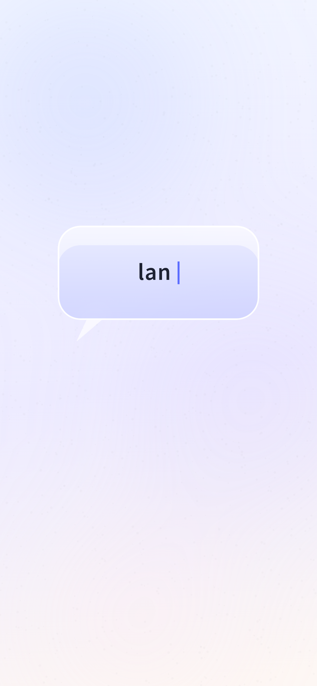
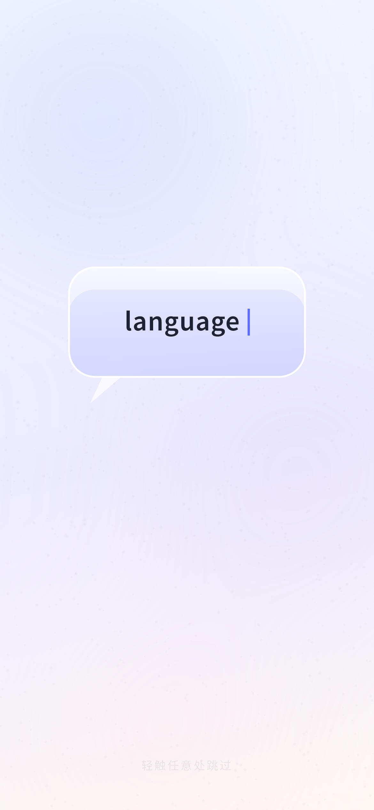
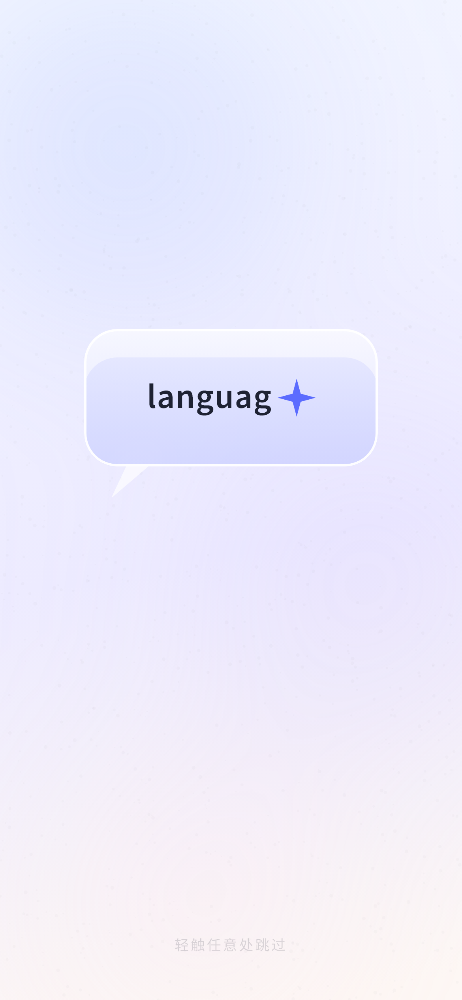
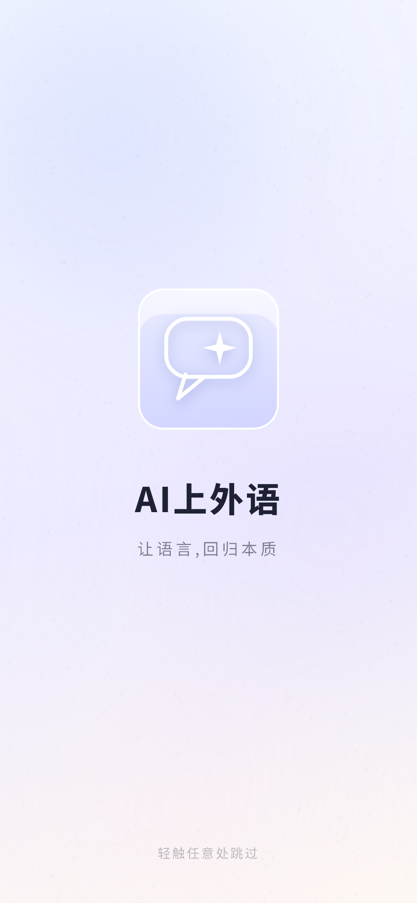

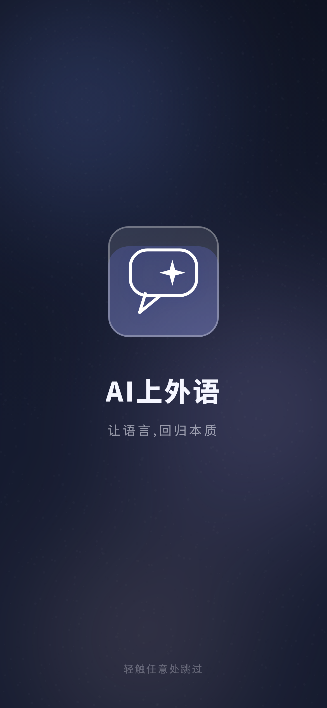

**概念**：琉璃对话气泡浮起，`language` 逐字打出（光标在跳）；打到最后一个字母时，
**那颗字符被星芒顶掉**（AI 介入），气泡随之收成「气泡 · 星」。

**为什么贴合**：这个 App 的本质就是**和 AI 对话学语言**。"星芒顶掉最后一个字符"是一个动作隐喻：
AI 不是替你说话，是在你要说的那句话里接一下。

### 4.1 时序表（总 1.44s）

| 层 | 属性 | 起–止 (ms) | 曲线 |
|---|---|---|---|
| 背景极光 | opacity 0.55→1.00 | 60–260 | easeOut |
| 气泡 | opacity 0→1；scale 0.92→1 | 60–260 | easeOutCubic |
| 打字 | 8 个字符依次出现（≈65ms/字符） | 260–760 | 线性 |
| 光标 | 常驻闪烁（实现用 500ms 方波） | 260–780 | — |
| 星芒顶替末字符 | scale 0.2→1.0 | 780–900 | easeOutBack |
| 气泡收缩 | 248×116 → 132×132；圆角 28→24 | 920–1100 | easeOutCubic |
| 收成标 | opacity 0→1 | 1080–1240 | linear |
| 字标 / 副标 | 同 A | 1020–1340 / 1100–1440 | 同 A |
| 跳过提示 | opacity 0→0.85 | 700–1000 | linear |

---

## 5. Logo：三个概念（每个都要读出 AI + language）

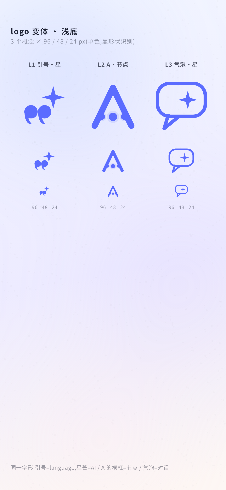
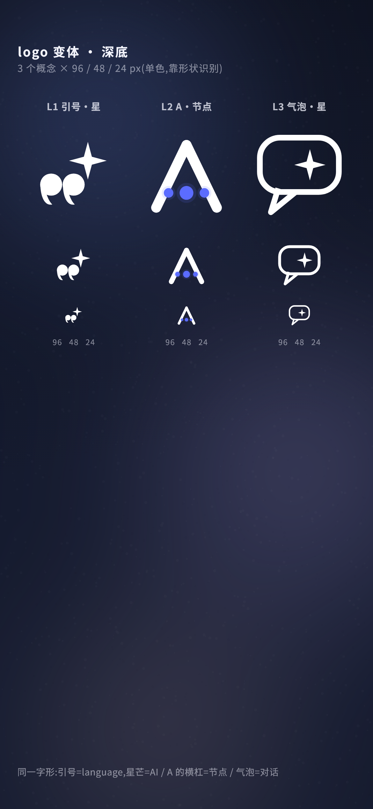

> 变体图里每个标都在 **96 / 48 / 24 px** 三档 + 浅底/深底各出一遍，单色绘制（浅底用 `#5B6CFF`、深底用白），
> 就是"单色可识别性"的现场验收。

### 5.1 L1「引号 · 星」= language + AI

- **language**：左下一对**逗号引号**（圆头 + 左下勾尾），占宽 0.12–0.62，高度 0.48–0.72；
- **AI**：右上**四角星芒**，圆心 `(0.68, 0.33)`、外径 `0.215`、内凹 `0.30R`，与第二枚引号右上**相切收紧**
  （不是飘在旁边，而是"嵌进去"）；
- **比例**：整体 84 框内，引号 r=0.12、星 R=0.215；两元素重心一低一高，形成对角张力；
- **24px**：引号是两个实心点 + 小尾，星芒是 4 角亮点 —— 主形"两点 + 一星"仍可辨；
- **launcher**：前景 = 白标（108dp 画布内占 62%），背景 = `#7C9BFF→#C86BFF` 135° 渐变。

### 5.2 L2「A · 节点」= 字母 + AI 脉络

- **language**：主体是字母 **A**（stroke 0.110，顶点 `(0.50,0.17)`、两脚 `(0.17,0.85)/(0.83,0.85)`）；
- **AI**：A 的横杠**不是线，是三颗节点**（半径 0.052 / 0.075 / 0.052，色 `#5B6CFF` + 20% 柔光）；
- **24px**：A 主形最稳；节点在 24px 会糊 → **分级**：<32px 用实心横杠（先保 A）；
- **launcher**：白 A + `#5B6CFF` 节点，背景渐变同上；单色版（monochrome）把节点放大到 0.09/0.13。

### 5.3 L3「气泡 · 星」= 对话 + AI

- **language**：**对话气泡 + 尾巴**（气泡 0.07–0.93 × 0.09–0.68，圆角 0.22；尾巴三点 Path）；
- **AI**：气泡内右侧**星芒**，圆心 `(0.615,0.385)`、外径 `0.170`；
- **24px**：描边按 `0.062×尺寸` 缩放（24px→1.5px，不会细到消失）；
- **launcher**：白色气泡+星 on 渐变底；monochrome 同 L1 处理。

### 5.4 与桌面图标的关系（建议一起换，成本 0.5 小时）

现状：`android/app/src/main/res/mipmap-*/ic_launcher.png` 五套 PNG 是「AI language」立体字 + 米白底，
**没有** `mipmap-anydpi-v26` 自适应图标 → 桌面与开屏是两套标记。
选定方案后按 §7 的生成方案一起替换。

---

## 5.5 推荐：A「琉璃凝结 · 双元素汇合」

**为什么它最能同时表达 AI 与 language**：

1. **终标是两个符号的"并置"，不是派生**：L1 里「引号」（左下）与「星芒」（右上）各占一块、
   谁也不是谁的变形 —— 不用解释，一眼就是"语言 + AI"。
   对比：B 的终标是 A + 节点（要解释"节点 = AI"）；C 的终标是气泡 + 星（气泡读作"对话"，
   比"引号 = 语言"弱半档，且星芒在气泡里更像装饰）。
2. **动画把论点演了一遍**：两条**独立**元素从左右滑入 → 靠近（f2）→ 相撞（f3）→ 合成（f4）。
   三个方案里只有 A 用"两个元素走到一起"这个动作直接表达"AI 与语言在一起"。
3. **正中用户的琉璃诉求**：132 琉璃块是画面主体、磨砂→澄澈是全片唯一的大材质变化；
   C 的琉璃只是一个气泡，B 的琉璃到终帧才出现。
4. **24px 也站得住**：引号是两个实心点 + 小尾、星芒是 4 角亮点（见 `splash-logo-sheet*.png` 的 24px 行）。
5. **成本与风险最低**：1 个 controller、1 处 132² 的 `BackdropFilter`、1 层静态背景 blur；
   降级路径明确（见 §8）。

**备选**：更看重"产品在讲学习闭环"选 **B**；更想要"AI 帮我写/改"的产品感、能接受打字机节奏选 **C**。
三者可组合：**A 的开场 + B 的收束标**（玻璃凝结后环收成闭环），改动量约等于 B。

---

## 6. 实现规格（选定即可进包）

### 6.1 文件结构

```
lib/widgets/splash_graphics.dart   ← 新增(~420 行):背景/琉璃块/三个 mark 的 CustomPainter + 纯函数组件
lib/screens/splash_screen.dart     ← 重写 build(保留 SplashSettings.tagline / 点击跳过 / 250ms 交叉淡出)
lib/services/splash_settings.dart  ← 不动
lib/app.dart                       ← 不动(SplashScreen(child: AboutNoticeGate(...)) 结构不变)
```

### 6.2 把"纯函数预览"直接搬进生产（零落差）

预览测试里每个方案就是 `(t 秒, dark) -> Widget`。生产端只要把 `t` 接到 controller：

```dart
class _SplashScreenState extends State<SplashScreen>
    with SingleTickerProviderStateMixin {
  late final AnimationController _ctrl = AnimationController(
    vsync: this,
    duration: const Duration(milliseconds: 1500), // 略长于动画总长,留静止尾
  )..addStatusListener((s) {
      if (s == AnimationStatus.completed) _finish();
    });

  bool _done = false;

  void _finish() {
    if (!mounted || _done) return;
    setState(() => _done = true);          // 走现有 250ms AnimatedSwitcher
  }

  @override
  Widget build(BuildContext context) {
    final dark = Theme.of(context).brightness == Brightness.dark;
    // 减少动效:直接出终帧 + 200ms 淡入(见 §8)
    final reduce = MediaQuery.maybeOf(context)?.disableAnimations ?? false;
    return GestureDetector(
      behavior: HitTestBehavior.opaque,
      onTap: _finish,                      // 点击跳过:保留
      child: AnimatedSwitcher(
        duration: const Duration(milliseconds: 250),
        child: _done
            ? widget.child
            : AnimatedBuilder(
                animation: _ctrl,
                builder: (_, __) => SplashKineticA(   // ← 预览里的 _SplashA
                  t: reduce ? 1.5 : _ctrl.value * 1.5,
                  dark: dark,
                  tagline: SplashSettings.tagline(),  // 文案可自定义:保留
                ),
              ),
      ),
    );
  }
}
```

> 三个方案各对应一个 `SplashKineticA / B / C` 组件，内部就是本文时序表里的
> `t = _seg(区间)` + `_lerp`，**与预览代码逐行一致**。

### 6.3 每方案的层与成本

| | A | B | C |
|---|---|---|---|
| 层数 | 背景层 + 琉璃块(内含 4 层:填充/高光/高光带/内高光边) + 3 个元素(引号层/星芒层/合成标) + 字标组 | 背景层 + 双环 painter + 琉璃块 + A·节点 mark + 字标组 | 背景层 + 气泡(含尾巴/文本/星) + 合成标 + 字标组 |
| AnimationController | **1 个**(1500ms,一次 forward) | 1 个 | 1 个 |
| 曲线 | 全部 `Curves.easeOutCubic`(线性的只有"磨砂/高光扫/打字") | 同 | 同 |
| `BackdropFilter` 范围 | **仅 132×132 一块**(磨砂 sigma 16→4) | 仅 132×132 一块(终帧才出现) | 仅气泡 248×116 一块(sigma 14) |
| 背景 blur | `ImageFiltered(blur 64)` 一层,**静态**(只 opacity 变化),可整层缓存 | 同 | 同 |
| 帧预算 | 唯一每帧变的是 Transform/Opacity(便宜);blur 只在 260–900ms 区间参数变化 | 环 painter 每帧重绘(几十条线,极便宜) | 打字改 `substring`(便宜) |

### 6.4 CustomPainter 参数（照抄即可）

```dart
// 引号(逗号形):圆心 +(左下勾尾),r = 0.12×框宽
void _drawComma(Canvas c, Offset o, double r, Color color) {
  c.drawCircle(o, r, Paint()..color = color);
  final tail = Path()
    ..moveTo(o.dx - r * .98, o.dy + r * .05)
    ..cubicTo(o.dx - r * .95, o.dy + r * 1.05, o.dx - r * .62, o.dy + r * 1.95,
              o.dx + r * .10, o.dy + r * 1.80)
    ..cubicTo(o.dx - r * .50, o.dy + r * 1.15, o.dx - r * .32, o.dy + r * .55,
              o.dx - r * .98, o.dy + r * .05)
    ..close();
  c.drawPath(tail, Paint()..color = color);
}

// 四角星芒:外径 R,内凹 0.30R
Path _starPath(Offset o, double R) { /* 4 个外点 + 4 个内点,闭合 */ }

// L2「A · 节点」斜边:strokeWidth = 0.110×框宽,圆头圆角
// 节点半径比例 0.052 / 0.075 / 0.052,色 #5B6CFF,外圈 1.9 倍 @20% 柔光
// L3 气泡:RRect 0.07–0.93 × 0.09–0.68,圆角 0.22,描边 = 0.062×尺寸
// 投影:同一 Path 画两遍 —— 下层 #40213896 + ImageFiltered(blur 6) + translate(0,3),上层纯白
```

---

## 7. Android launcher icon 方案（纯 Dart 生成，不引依赖）

### 7.1 文件清单（生成后放进仓库）

```
android/app/src/main/res/
├─ mipmap-mdpi/ic_launcher.png                 48×48
├─ mipmap-hdpi/ic_launcher.png                 72×72
├─ mipmap-xhdpi/ic_launcher.png                96×96
├─ mipmap-xxhdpi/ic_launcher.png               144×144
├─ mipmap-xxxhdpi/ic_launcher.png              192×192
├─ mipmap-anydpi-v26/ic_launcher.xml           ← 自适应图标(纯 XML)
├─ drawable/ic_launcher_background.xml         ← 渐变 background(纯 XML,不需要 PNG)
├─ drawable-mdpi/ic_launcher_foreground.png    108×108   (画布 108dp,内容缩到 62% 安全区)
├─ drawable-hdpi/ic_launcher_foreground.png    162×162
├─ drawable-xhdpi/ic_launcher_foreground.png   216×216
├─ drawable-xxhdpi/ic_launcher_foreground.png  324×324
├─ drawable-xxxhdpi/ic_launcher_foreground.png 432×432
└─ drawable-*/ic_launcher_monochrome.png       同尺寸,单色剪影(Android 13 主题图标)
```

`mipmap-anydpi-v26/ic_launcher.xml`：

```xml
<?xml version="1.0" encoding="utf-8"?>
<adaptive-icon xmlns:android="http://schemas.android.com/apk/res/android">
  <background android:drawable="@drawable/ic_launcher_background"/>
  <foreground android:drawable="@drawable/ic_launcher_foreground"/>
  <monochrome android:drawable="@drawable/ic_launcher_monochrome"/>
</adaptive-icon>
```

`drawable/ic_launcher_background.xml`：

```xml
<?xml version="1.0" encoding="utf-8"?>
<shape xmlns:android="http://schemas.android.com/apk/res/android"
       android:shape="rectangle">
  <gradient android:type="linear" android:angle="315"
            android:startColor="#7C9BFF" android:endColor="#C86BFF"/>
</shape>
```

`AndroidManifest.xml` 不用改（`android:icon="@mipmap/ic_launcher"` 命中 anydpi-v26 优先）。

### 7.2 生成器（**已实现**：`test/gen_icons_test.dart` → 产物 `build/gen_icons/`）

> 为什么放 `test/` 而不是 `tool/`:图标靠 `dart:ui` 的 `PictureRecorder + toImage`,
> 那是 Flutter 引擎能力,`dart run` 跑不起来;`flutter test test/gen_icons_test.dart --no-pub`
> 一次出全部 PNG。**不写 android/ 目录**(由 Lead 拷入 res)。

已跑通,产物 16 张:

```
build/gen_icons/
├─ ic_launcher_1024.png                1024×1024   ← 商店/宣传主图(不进 res)
├─ mipmap-mdpi/ic_launcher.png         48×48
├─ mipmap-hdpi/ic_launcher.png         72×72
├─ mipmap-xhdpi/ic_launcher.png        96×96
├─ mipmap-xxhdpi/ic_launcher.png       144×144
├─ mipmap-xxxhdpi/ic_launcher.png      192×192
├─ drawable-mdpi/ic_launcher_foreground.png      108×108
├─ drawable-hdpi/ic_launcher_foreground.png      162×162
├─ drawable-xhdpi/ic_launcher_foreground.png     216×216
├─ drawable-xxhdpi/ic_launcher_foreground.png    324×324
├─ drawable-xxxhdpi/ic_launcher_foreground.png   432×432
└─ drawable-*/ic_launcher_monochrome.png          同尺寸(单色剪影,Android 13 主题图标)
```

拷贝映射(Lead 做):

| 从 | 到 |
|---|---|
| `build/gen_icons/mipmap-*/ic_launcher.png` | `android/app/src/main/res/mipmap-*/ic_launcher.png`(覆盖旧的「AI language」图) |
| `build/gen_icons/drawable-*/ic_launcher_foreground.png` | `android/app/src/main/res/drawable-*/ic_launcher_foreground.png` |
| `build/gen_icons/drawable-*/ic_launcher_monochrome.png` | `android/app/src/main/res/drawable-*/ic_launcher_monochrome.png` |
| `build/gen_icons/ic_launcher_1024.png` | 不进 res(商店/文档用) |

生成器实现要点(与仓库里的 `test/gen_icons_test.dart` 一致):

```dart
// flutter test test/gen_icons_test.dart --no-pub
// 每个密度原生渲染:PictureRecorder → paintSplashMark(canvas, Size(box,box), Colors.white)
//                   → endRecording().toImage(px, px) → PNG 字节
// 传统图标:渐变底 + 白标,fill 0.78;自适应前景:透明底 + 白标,fill 0.62(落在 66dp 安全区);
// monochrome:透明底 + 白剪影(系统会按壁纸染色)。
```
  File(path).writeAsBytesSync(data!.buffer.asUint8List());
}

/// fill:标占画布的比例(传统图标 .78 / 自适应前景 .62);mono:单色剪影
Future<void> _render({
  required int px,
  required String path,
  required double fill,
  required bool mono,
  required bool withBg,
}) async {
  final rec = ui.PictureRecorder();
  final c = Canvas(rec);
  final full = px.toDouble();
  if (withBg && !mono) {
    c.drawRect(Rect.fromLTWH(0, 0, full, full), Paint()
      ..shader = const LinearGradient(
        begin: Alignment.topLeft, end: Alignment.bottomRight,
        colors: <Color>[Color(0xFF7C9BFF), Color(0xFFC86BFF)],
      ).createShader(Rect.fromLTWH(0, 0, full, full)));
  }
  final box = full * fill;
  final off = (full - box) / 2;
  c.save();
  c.translate(off, off);
  paintQuoteStar(c, Size(box, box), mono ? Colors.white : Colors.white);
  c.restore();
  final img = await rec.endRecording().toImage(px, px);
  await _save(img, path);
  img.dispose();
}

void main() {
  TestWidgetsFlutterBinding.ensureInitialized();
  testWidgets('生成 launcher icons', (_) async {
    const legacy = {48: 'mipmap-mdpi', 72: 'mipmap-hdpi', 96: 'mipmap-xhdpi',
                    144: 'mipmap-xxhdpi', 192: 'mipmap-xxxhdpi'};
    legacy.forEach((px, dir) => _render(
        px: px, path: '$_res/$dir/ic_launcher.png',
        fill: 0.78, mono: false, withBg: true));

    const adaptive = {108: 'drawable-mdpi', 162: 'drawable-hdpi',
                      216: 'drawable-xhdpi', 324: 'drawable-xxhdpi',
                      432: 'drawable-xxxhdpi'};
    adaptive.forEach((px, dir) {
      _render(px: px, path: '$_res/$dir/ic_launcher_foreground.png',
          fill: 0.62, mono: false, withBg: false);
      _render(px: px, path: '$_res/$dir/ic_launcher_monochrome.png',
          fill: 0.62, mono: true, withBg: false);
    });
  });
}
```

要点：**每个密度原生渲染**（不是放大缩小），所以 48px 的引号/星芒边缘是干净的；
`paintQuoteStar(Canvas, Size, Color)` 就是 `splash_graphics.dart` 里 mark 的绘制函数，
开屏与桌面图标**共用同一份 Path**,永远不会画歪。

### 7.3 可选：Android 12+ 系统开屏衔接

Flutter 模板已有 `android/app/src/main/res/values/styles.xml` 的 `LaunchTheme`，
新增 `values-v31/styles.xml` 两项即可（v31+ 才生效，不影响老机型）：

```xml
<style name="LaunchTheme" parent="@android:style/Theme.Light.NoTitleBar">
  <item name="android:windowSplashScreenBackground">#F2F5FF</item>
  <item name="android:windowSplashScreenAnimatedIcon">@drawable/ic_launcher_foreground</item>
</style>
```

这样「系统开屏（图标）→ Flutter 开屏（琉璃动画）」颜色与标记连续，不会闪一下白屏。

---

## 8. 降级 / 性能 / 不冲突确认

| 场景 | 处理 |
|---|---|
| 减少动效（无障碍） | `MediaQuery.of(context).disableAnimations` → 直接渲染 `t = 1.5` 的**终帧** + 200ms 淡入；不做位移/扫光/打字 |
| 低端机掉帧 | ① 背景 `ImageFiltered(blur 64)` 若成为热点：换成纯 `RadialGradient` 叠加（视觉几乎不变）；② 琉璃块 `BackdropFilter` 保留（面积仅 132²）；③ 曲线全部 easeOutCubic，无长尾动画 |
| 极低端兜底 | `--dart-define=SPLASH_STATIC=true` 时直接走静态版（同减少动效分支），一行开关 |
| 点击跳过 | 整屏 `GestureDetector(HitTestBehavior.opaque)` → `_finish()`；提示 0.7s 后出现，不打断先手操作 |
| 文案自定义 | `SplashSettings.tagline()` 每次 build 读；`maxLines: 2` + `ellipsis`；左右 padding 32 |
| 深色 | 全部走 `V4Skin` 的 jelly 双套 + 本方案深色常量；不需要新主题 |
| **AboutNoticeGate** | **不冲突**：`app.dart:59–62` 是 `SplashScreen(child: AboutNoticeGate(child: RootShell))`，`AboutNoticeGate` 只在 `_done == true` 后才首次 build（即 250ms 交叉淡出开始之后）→ 首启公告弹在开屏之后，顺序与现在完全一致；本方案只改开屏自己的画面，不动 `AnimatedSwitcher` 与挂载结构 |
| 退出即释放 | `dispose()` 里 `_ctrl.dispose()`；`BackdropFilter`/`ImageFiltered` 随页面销毁，不残留 |

---

## 9. 渲染帧清单（17 张，`docs/ui-preview/real/`）

| 方案 | 文件 | 看什么 |
|---|---|---|
| A | `splash-a-f1.png` | 两个元素分开（引号左、星芒右） |
| A | `splash-a-f2.png` | 相向靠近 |
| A | `splash-a-f3.png` | 相撞 + 融合波 |
| A | `splash-a-f4.png` | **终帧**：琉璃块 + 合成标 + 字标 + 副标 |
| A | `splash-a-dark.png` | 深色终帧 |
| B | `splash-b-f1.png` | 语言流浮现、内环起弧 |
| B | `splash-b-f2.png` | **双轨同时在场，光点在跑** |
| B | `splash-b-f3.png` | 收束进环心 |
| B | `splash-b-f4.png` | 终帧：琉璃块里的「A · 节点」 |
| B | `splash-b-dark.png` | 深色终帧 |
| C | `splash-c-f1.png` | 气泡 + 打字中 |
| C | `splash-c-f2.png` | 打满 `language` + 光标 |
| C | `splash-c-f3.png` | **星芒顶掉末字符** |
| C | `splash-c-f4.png` | 终帧：收成「气泡 · 星」 |
| C | `splash-c-dark.png` | 深色终帧 |
| — | `splash-logo-sheet.png` | 3 概念 × 96/48/24 × 浅底 |
| — | `splash-logo-sheet-dark.png` | 3 概念 × 96/48/24 × 深底 |

生成命令（走全局锁，避开主线）：

```bash
bash tool/lockrun.sh test test/splash_preview_test.dart --no-pub
```

---

## 10. 验收清单（选定后照着测）

1. 真机冷启动 ≤ 0.3s 内出画面（首帧就是背景 + 琉璃块，不是白屏）；
2. 1.5s 内动画走完，字标/副标**清晰不发灰**（对比度按 §1 的色值验收）；
3. 点任意处立刻跳过 → 250ms 交叉淡出进主页；
4. 深色模式：底色 `#0E1220→#141A2E`、文字 `#F5F6FF`，无"白闪"；
5. 首启：开屏结束后才弹「关于」公告（AboutNoticeGate 顺序不变）；
6. 设置里改开屏文案 → 下次冷启生效（`SplashSettings.tagline()`）；
7. 打开系统「移除动画」/开发者选项动画 0.5×：开屏退化为静态终帧 + 200ms 淡入；
8. 桌面图标与新 logo 一致（自适应图标在 Android 8+ 生效，12+ 圆形/主题图标正常）。
