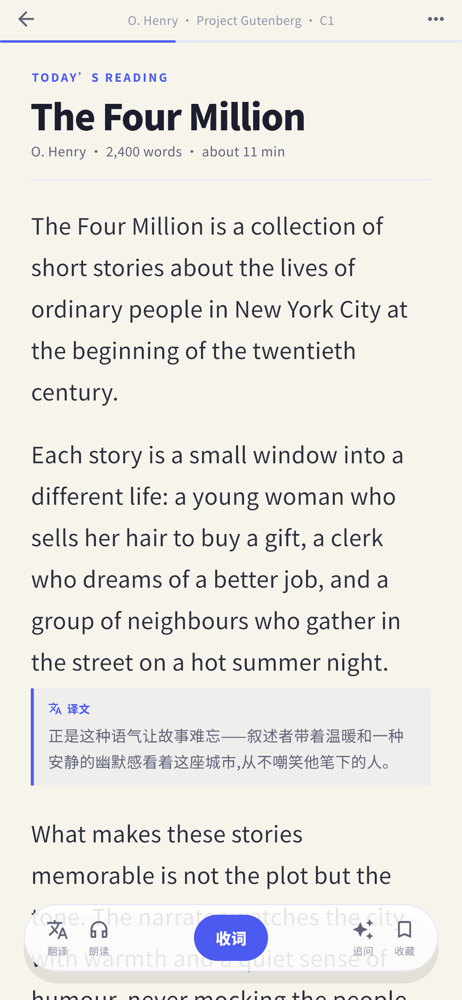
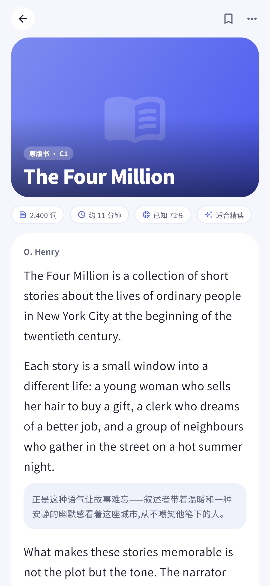
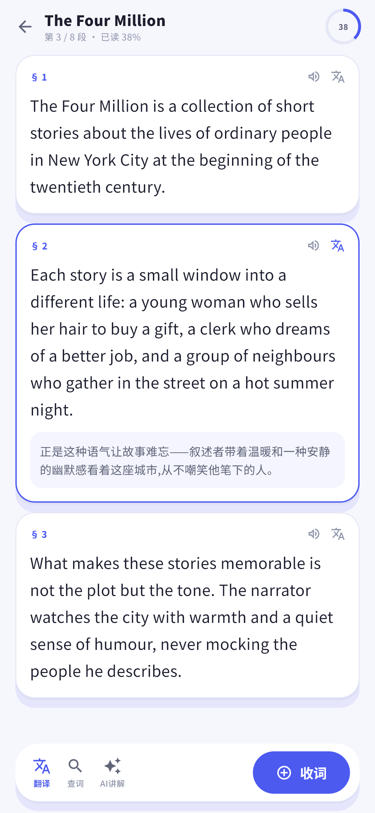

# 阅读器改版 · 3 个设计方向（待用户选型）

> 用户 2026-11-04 明确:"不要再蒙着头让我开盲盒,先给几个预览方案"。
> 下面三张是**生产组件渲染的设计预览**(390×844,真实配色/字体/间距),选定一个后
> 再落到 `lib/screens/input/material_reader_screen.dart` 的生产代码。

## 方案 A · 沉浸纸面(reader-plan-a.png)

- **关键词**:纸感、安静、正文第一。不要彩色大头部,不要卡片套卡片。
- 顶部只有一条极细工具行(返回 / 来源 / 更多)+ 2px 进度线;
- 正文用大字号、宽行距、衬线体;段落之间留白充足;
- 译文以"左竖线 + 浅底"嵌在对应段落下,不打断阅读;
- 底部是**悬浮玻璃胶囊**(翻译 / 朗读 / 收词主按钮 / 追问 / 收藏)。
- 适合:长时间精读、想沉浸读原著的用户。

## 方案 B · 杂志封面(reader-plan-b.png)

- **关键词**:有封面、有仪式感、材料身份强。
- 顶部是大封面 hero(书名压在封面上),下面一排词数/时长/已知%/难度胶囊;
- 正文是一整张白色大圆角卡;译文用浅底小卡嵌在段落之间;
- 底部两个等宽主操作(全文翻译 / 生词练习)。
- 适合:以"一篇一篇材料"为单位的学习者,喜欢看到封面与来源。

## 方案 C · 学习工作台(reader-plan-c.png)

- **关键词**:工具感、逐段处理、学习动作贴段。
- 顶部紧凑标题 + 阅读进度环(第 3/8 段 · 已读 38%);
- **每段一张卡**,卡上直接给"朗读 / 翻译"按钮;译文贴在段内;
- 底部工具条:翻译 / 查词 / AI 讲解 + 主按钮"收词"。
- 适合:边读边收词、逐段精读、做题式学习。

## 选型建议

- 追求"高级、不喧宾夺主、读着舒服" → **A**
- 追求"材料有身份、封面好看、分享感" → **B**
- 追求"学习工具感、逐段处理效率" → **C**
- 也可以组合:A 的纸面正文 + C 的逐段操作,或 B 的封面 + A 的底栏。
